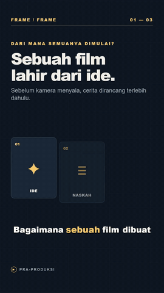
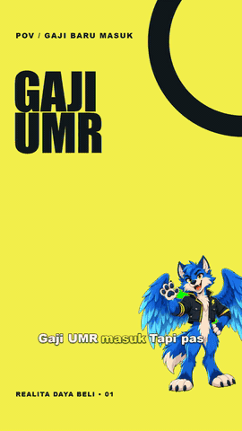
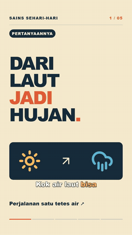
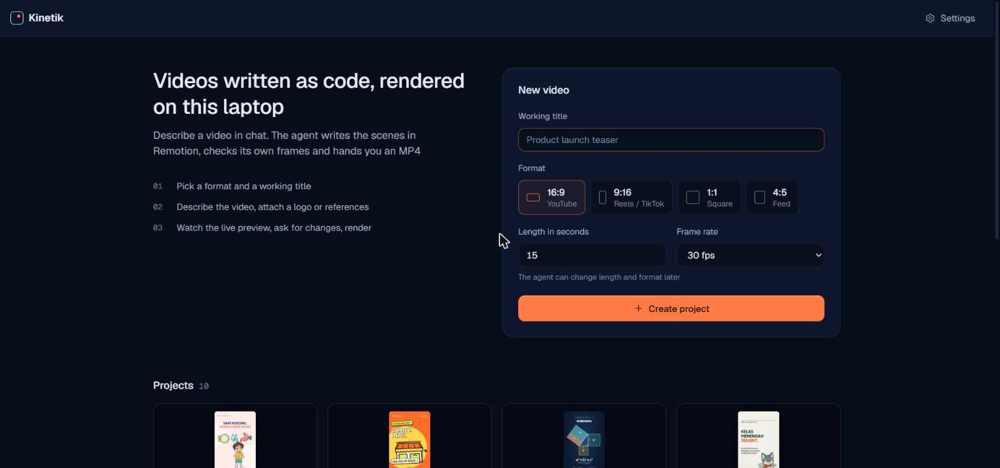
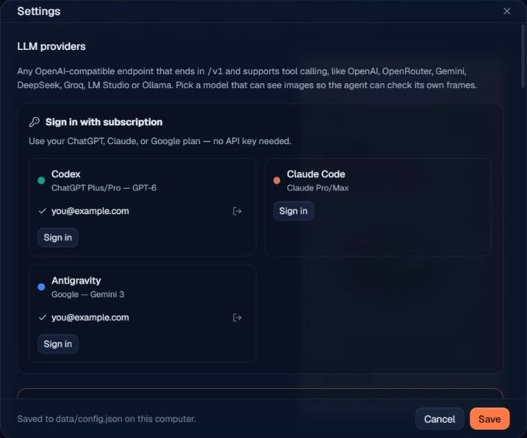
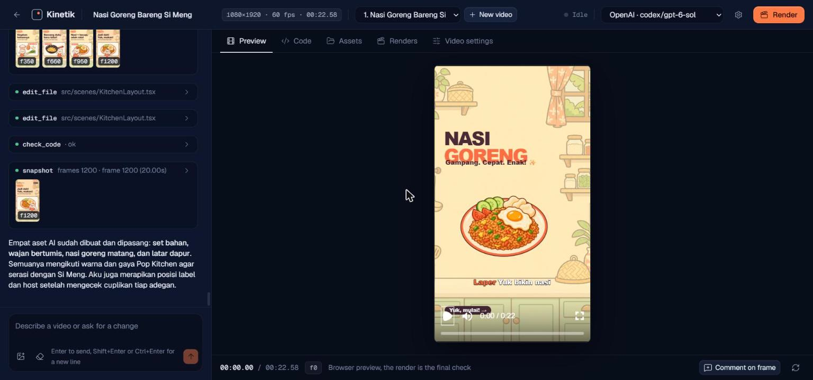
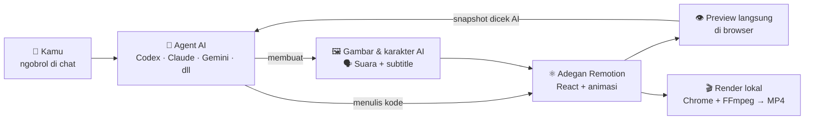

<div align="center">


### Ceritakan videonya. AI yang menulis, menganimasikan, dan merender — langsung di laptopmu.

[](https://github.com/onesyah05/kinetik/releases)
[](https://www.npmjs.com/package/kinetik-studio)
[](https://nodejs.org)
[](https://www.remotion.dev)
[](#-mulai-dalam-5-menit)

[**Lihat contoh**](#-contoh-video) · [**Mulai sekarang**](#-mulai-dalam-5-menit) · [**Cara pakai**](#-cara-pakai) · [**Unduh rilis**](https://github.com/onesyah05/kinetik/releases/latest)

</div>

---

## ✦ Apa itu Kinetik?

**Kinetik** adalah studio video bertenaga AI yang berjalan di komputermu sendiri. Kamu cukup mengetik ide seperti
*"buat video 30 detik tentang kenapa hujan turun, gaya kartun, suara perempuan"*, lalu agent AI akan:

1. 🎨 menawarkan **3 pilihan gaya visual** (dibuat dengan AI) untuk kamu pilih,
2. ✍️ menulis setiap adegan, teks, dan animasinya,
3. 🗣️ membuat **suara narasi + subtitle** yang sinkron per kata,
4. 🖼️ menggambar **karakter dan ilustrasi** sendiri, lengkap dengan animasinya,
5. 👀 **mengecek hasilnya sendiri** (teks terpotong, warna bertabrakan) lalu memperbaikinya,
6. 🎬 merender **file MP4** siap upload ke TikTok, Reels, Shorts, atau YouTube.

Tanpa aplikasi edit video, tanpa timeline, tanpa biaya render di cloud.

---

## 🎞 Contoh video

Semua video di bawah ini dibuat **sepenuhnya oleh agent Kinetik** dari satu kalimat permintaan. Klik untuk menonton versi MP4 lengkapnya.

<table>
  <tr>
    <td align="center" width="25%">
      <a href="https://github.com/onesyah05/kinetik/releases/download/v0.1.0/contoh-film-dibuat.mp4"></a>
      <br /><b>Bagaimana Film Dibuat?</b><br /><sub>Dokumenter gelap · 32 dtk</sub>
    </td>
    <td align="center" width="25%">
      <a href="https://github.com/onesyah05/kinetik/releases/download/v0.1.0/contoh-umr-vs-sembako.mp4"></a>
      <br /><b>UMR vs Harga Sembako</b><br /><sub>Konten opini + maskot AI · 43 dtk</sub>
    </td>
    <td align="center" width="25%">
      <a href="https://github.com/onesyah05/kinetik/releases/download/v0.1.0/contoh-laut-jadi-hujan.mp4"></a>
      <br /><b>Dari Laut Jadi Hujan</b><br /><sub>Edukasi sains · 45 dtk</sub>
    </td>
    <td align="center" width="25%">
      <a href="https://github.com/onesyah05/kinetik/releases/download/v0.1.0/contoh-nasi-goreng.mp4"></a>
      <br /><b>Nasi Goreng Bareng Si Meng</b><br /><sub>Resep + karakter kucing · 23 dtk</sub>
    </td>
  </tr>
</table>

<sub>Pratinjau di atas dipercepat 3×. Video aslinya 1080×1920 dengan suara narasi dan subtitle.</sub>

---

## ⚡ Fitur unggulan

| | Fitur | Penjelasan singkat |
|---|---|---|
| 💬 | **Cukup ngobrol** | Jelaskan videonya pakai bahasa sehari-hari. Agent membalas dalam bahasamu. |
| 🎨 | **Pilih gaya dari gambar AI** | Untuk video baru, agent membuat 3 gambar contoh gaya sekaligus. Pilih satu, semua adegan dan aset mengikuti gaya itu. |
| 🔑 | **Login pakai langganan** | Masuk dengan akun **ChatGPT (Codex)**, **Claude**, **Google (Antigravity)**, atau **Meta (Muse Code)**. Tidak perlu API key. |
| 🔁 | **Semua ikut model pilihanmu** | Ganti model di project, maka pembuatan gambar, animasi karakter, dan pengecekan ikut pindah otomatis. |
| 🖼️ | **Gambar & karakter AI** | Ilustrasi dengan latar transparan otomatis, karakter yang konsisten di banyak pose, dan animasi frame-by-frame. |
| 🗣️ | **Suara + subtitle gratis** | Narasi Edge TTS (Indonesia & banyak bahasa) dengan subtitle per kata. Bisa dimatikan atau diganti gayanya. |
| 📚 | **Banyak video, satu gaya** | Tulis beberapa tema sekaligus, satu baris satu video. Semuanya memakai gaya, suara, dan aset yang sama. |
| ✏️ | **Edit & kirim ulang** | Salah ketik? Edit pesanmu atau kirim ulang, agent mengulang dari titik itu. |
| 👁️ | **Preview langsung** | Setiap perubahan kode langsung terlihat di preview, tanpa menunggu render. |
| 💻 | **Render di laptop sendiri** | Hasil akhir MP4 dirender lokal. Gratis, privat, dan bisa offline setelah aset siap. |
| 📲 | **Langsung posting ke Facebook Reels** | Satu klik dari hasil render. Caption dan hashtag yang sedang tren (huruf kecil semua) ditulis AI, lalu langsung tayang. |

---

## 🚀 Mulai dalam 5 menit

### 1 · Pasang kebutuhannya (sekali saja)

| Program | Untuk apa | Cara pasang |
|---|---|---|
| **Node.js 20+** | Menjalankan Kinetik | Unduh versi **LTS** di [nodejs.org](https://nodejs.org) |
| **FFmpeg** | Membuat file MP4 | Windows: `winget install Gyan.FFmpeg` · macOS: `brew install ffmpeg` · Linux: `sudo apt install ffmpeg` |
| **Python 3** | Suara narasi & latar transparan | [python.org](https://www.python.org/downloads/) — di Windows centang **"Add python.exe to PATH"** |

### 2 · Pasang Kinetik dengan satu perintah

Buka **Terminal** (Windows: tekan <kbd>Win</kbd>, ketik *Terminal*), lalu ketik:

```bash
npm install -g kinetik-studio
```

### 3 · Jalankan dari mana saja

```bash
kinetik
```

Browser otomatis terbuka di **http://localhost:3210**. Selesai! 🎉

> 💡 Pertama kali dijalankan, ketik `kinetik setup` untuk memasang paket suara narasi, dan `kinetik doctor` untuk mengecek apakah semuanya sudah siap.
> Biarkan jendela terminal tetap terbuka selama memakai Kinetik. Tekan <kbd>Ctrl</kbd>+<kbd>C</kbd> untuk mematikannya.

### Perintah yang tersedia

| Perintah | Fungsi |
|---|---|
| `kinetik` atau `kinetik start` | Menjalankan Kinetik dan membuka browser |
| `kinetik start --port 3300` | Memakai port lain |
| `kinetik start --no-open` | Menjalankan tanpa membuka browser |
| `kinetik start --home D:\VideoKu` | Menyimpan project di folder lain |
| `kinetik doctor` | Mengecek Node.js, FFmpeg, Python, dan paketnya |
| `kinetik setup` | Memasang paket Python (suara narasi, latar transparan) |
| `kinetik cli` | Ngobrol dengan agent langsung di terminal |
| `kinetik update` | Memasang versi terbaru (project tetap aman) |
| `kinetik update --check` | Hanya mengecek apakah ada versi baru |
| `kinetik home` | Menampilkan folder tempat project dan pengaturan disimpan |
| `kinetik --version` | Menampilkan versi |

### 🔄 Update ke versi terbaru

Kinetik mengecek versi baru sendiri. Kalau ada, muncul tombol oranye **Update to vX.Y.Z** di kanan atas aplikasi.

1. Klik tombolnya untuk melihat apa saja yang baru.
2. Klik **Update now**. Kinetik menutup diri, mengunduh versi baru, lalu menyala lagi. Halaman browser memuat ulang sendiri, biasanya dalam 1–3 menit.

Lewat terminal juga bisa:

```bash
kinetik update
```

Cara ini berlaku untuk semua cara pasang: npm, ZIP, maupun clone git. Saat Kinetik dijalankan, terminal juga memberi tahu kalau ada versi baru.

**Project kamu aman saat update.** Semua project, pengaturan, dan login disimpan di folder **`Kinetik`** di folder pengguna (contoh: `C:\Users\nama\Kinetik`), terpisah dari program.

> Masih memakai versi 0.3.0 atau lebih lama? Update sekali dengan `npm install -g github:onesyah05/kinetik` (hasil clone: `git pull`). Setelah itu tombol Update sudah tersedia.

<details>
<summary><b>Cara lain: tanpa npm (Windows, klik dua kali)</b></summary>

<br />

1. Buka halaman [**Releases**](https://github.com/onesyah05/kinetik/releases/latest), unduh **`kinetik-v0.6.0.zip`**, lalu ekstrak.
2. Klik dua kali **`Start-Kinetik.bat`**. Saat pertama kali, kebutuhannya dipasang otomatis (beberapa menit, sekali saja).
3. Browser terbuka di **http://localhost:3210**.

</details>

<details>
<summary><b>Cara lain: langsung dari GitHub / untuk developer</b></summary>

<br />

```bash
# pasang perintah kinetik langsung dari GitHub
npm install -g github:onesyah05/kinetik

# atau clone untuk mengubah kodenya
git clone https://github.com/onesyah05/kinetik.git
cd kinetik
npm install
pip install -r requirements.txt
npm start
```

Saat dijalankan dari hasil clone, project disimpan di folder `workspace/` di dalam repo.

</details>

---

## 🧭 Cara pakai



**1. Hubungkan AI.** Klik ikon ⚙️ **Settings** → **Sign in with subscription**, lalu login dengan akun ChatGPT, Claude, Google, atau Meta yang kamu punya. Atau isi API key dari OpenAI, OpenRouter, Gemini, dan lainnya.

<p align="center"></p>

**2. Buat project.** Isi judul, pilih format (**9:16** untuk TikTok/Reels, **16:9** untuk YouTube), lalu klik **Create project**.

**3. Ceritakan videonya di chat.** Contoh:

> *Buat video 30 detik tentang kenapa kucing suka kotak. Gaya kartun lucu, suara perempuan ceria, ada maskot kucing oranye.*

**4. Pilih gaya.** Agent menampilkan 3 gambar contoh gaya. Klik **Use this style** pada yang kamu suka. Mau versi lain? Klik **Regenerate**.

**5. Tonton & revisi.** Preview langsung muncul di kanan. Minta perubahan lewat chat, misalnya *"judulnya lebih besar"* atau *"ganti warnanya jadi biru"*.



**6. Render.** Klik tombol oranye **Render**, pilih kualitas, tunggu, lalu unduh MP4-nya dari tab **Renders**. Kalau project-mu punya beberapa video, centang video mana saja yang mau dirender (atau **Select all**). Setiap video jadi file MP4 sendiri.

**7. Posting ke Facebook Reels (opsional).** Di setiap hasil render ada tombol **Post to Reels**. Cukup sekali klik: AI menulis caption dari narasi videonya plus hashtag huruf kecil yang sedang ramai, lalu video langsung diunggah dan tayang di Halamanmu. Caption yang diposting ditampilkan di bawah videonya.

**Bonus — bikin seri video:** klik **New video** di atas, tulis beberapa tema (satu per baris), dan agent membuat semuanya dengan gaya yang sama.

<details>
<summary><b>Cara menyiapkan posting ke Facebook Reels</b></summary>

<br />

1. Buka [Meta for Developers](https://developers.facebook.com/apps/), buat aplikasi (tipe **Business**), lalu tambahkan produk **Facebook Login for Business**.
2. Buka [Graph API Explorer](https://developers.facebook.com/tools/explorer/). Pilih aplikasimu, lalu centang izin **`pages_show_list`**, **`pages_read_engagement`**, dan **`pages_manage_posts`**. Klik **Generate Access Token**.
3. Di menu **User or Page**, pilih Halaman Facebook-mu. Token yang muncul adalah **Page access token**. Supaya tidak cepat kedaluwarsa, perpanjang dulu lewat [Access Token Debugger](https://developers.facebook.com/tools/debug/accesstoken/) → **Extend Access Token**, lalu pilih Halamanmu lagi di Explorer.
4. **Page ID** ada di Halamanmu → **Tentang** → **Transparansi Halaman**.
5. Di Kinetik: ⚙️ **Settings** → **Facebook Reels**, isi keduanya, klik **Test connection**, lalu **Save**.

Syarat video dari Facebook: **9:16** (pilih format Reels/TikTok saat membuat project), durasi **3–90 detik**, minimal **540×960**. Kinetik mengeceknya sebelum mengunggah. Batasnya **30 Reels per Halaman setiap 24 jam** lewat API.

</details>

---

## 🧠 Cara kerjanya



Video di Kinetik adalah **kode React** (memakai [Remotion](https://www.remotion.dev)). Karena itu hasilnya tajam di resolusi apa pun, mudah direvisi, dan setiap teks atau angka bisa diubah tanpa membuat ulang dari awal.

---

## 🛠 Mengatasi masalah

| Masalah | Solusi |
|---|---|
| Model AI tidak muncul setelah login | Tutup jendela terminal Kinetik lalu jalankan lagi. |
| `fetch failed` saat membuat gambar | Buka **Settings → Image generation**, pilih **Same as the chat model**, lalu jalankan ulang Kinetik. |
| Tidak ada suara narasi | Pastikan Python terpasang, lalu jalankan `kinetik setup`. |
| Render gagal / "ffmpeg not found" | Pasang FFmpeg (`winget install Gyan.FFmpeg`), lalu buka terminal baru. |
| Laptop terasa berat saat render | Tutup aplikasi lain, atau turunkan *render concurrency* di Settings (default 2). |
| Port 3210 sudah dipakai | Kinetik mungkin sudah berjalan di jendela lain. Atau pakai port lain: `kinetik --port 3300`. |
| Perintah `kinetik` tidak dikenal | Tutup lalu buka lagi Terminal setelah `npm install -g`. Masih gagal? Cek `npm prefix -g` ada di PATH. |
| macOS/Linux: `EACCES` saat `npm install -g` | Pasang Node lewat [nvm](https://github.com/nvm-sh/nvm) agar tidak perlu `sudo`. |
| Update gagal | Tutup Kinetik (<kbd>Ctrl</kbd>+<kbd>C</kbd>), lalu jalankan `kinetik update` di terminal. Hasil clone yang kodenya kamu ubah: commit atau batalkan perubahannya dulu. |
| Tidak ingin dicek update | Jalankan dengan variabel `KINETIK_NO_UPDATE_CHECK=1`. |
| Ingin tahu apa yang kurang | Jalankan `kinetik doctor`. |

---

<details>
<summary><b>📁 Untuk developer — struktur project & perintah</b></summary>

<br />

```
server/            backend (Express + Vite middleware, satu port)
  agent/           loop agent, system prompt, definisi tools
  subscription/    login Codex / Claude / Antigravity / Muse + gateway OpenAI-compatible
  bundle.ts        bundle Rspack per project (di-cache berdasarkan hash source)
  render.ts        snapshot (renderStill) + render final (renderMedia)
  tts.ts / .py     Edge TTS + timing per kata
  media.ts         gambar AI, stok foto/video, unduhan
kit/               library '@kit' untuk adegan: Narration, Captions, AnimatedAsset, Sprite
templates/project  template project baru
web/               UI React (chat, preview, editor, aset, render, settings)
cli/               klien terminal (memakai core yang sama)
workspace/<id>/    project kamu: project.json, chat.json, src/, public/, renders/
data/              config.json, akun login (terenkripsi), cache bundle — tidak di-commit
```

| Perintah | Fungsi |
|---|---|
| `npm start` | Menjalankan server + UI di http://localhost:3210 (sama dengan `kinetik start --no-open`) |
| `npm run dev` | Mode pengembangan (server restart otomatis) |
| `npm run cli` | Klien terminal: `/render draft`, `/snap`, `/check`, `/exit` |
| `npm run typecheck` | Cek TypeScript |
| `npm run smoke` | Tes TTS → tulis adegan → cek → snapshot tanpa LLM |
| `npm run mock-llm` | LLM palsu di http://localhost:4010/v1 untuk tes |

Provider LLM apa pun yang kompatibel dengan OpenAI (`/v1`, tool calling, idealnya bisa melihat gambar) bisa dipakai: OpenAI, OpenRouter, Gemini, DeepSeek, Groq, LM Studio, Ollama, dan lainnya.

</details>

<details>
<summary><b>💡 Tips untuk laptop dengan RAM 8 GB</b></summary>

<br />

- Render concurrency default 2 (atur di Settings). Naikkan hanya kalau RAM masih longgar.
- Tutup aplikasi berat saat render. Chrome headless memakai RAM untuk setiap tab render.
- Snapshot pertama setelah server menyala lebih lambat (bundle + browser mulai). Berikutnya lebih cepat.
- Kalau Rspack bermasalah, pakai webpack: jalankan dengan variabel `KINETIK_BUNDLER=webpack`.

</details>

---

## 📜 Lisensi Remotion

Kinetik memakai [Remotion](https://www.remotion.dev) sebagai mesin video. Remotion gratis untuk individu dan perusahaan dengan maksimal 3 karyawan. Untuk tim yang lebih besar, cek [remotion.dev/license](https://remotion.dev/license).

<div align="center">
<br />
<sub>Dibuat dengan ⚡ di Indonesia · <a href="https://github.com/onesyah05/kinetik/releases">Rilis</a> · <a href="https://github.com/onesyah05/kinetik/issues">Laporkan masalah</a></sub>
</div>
